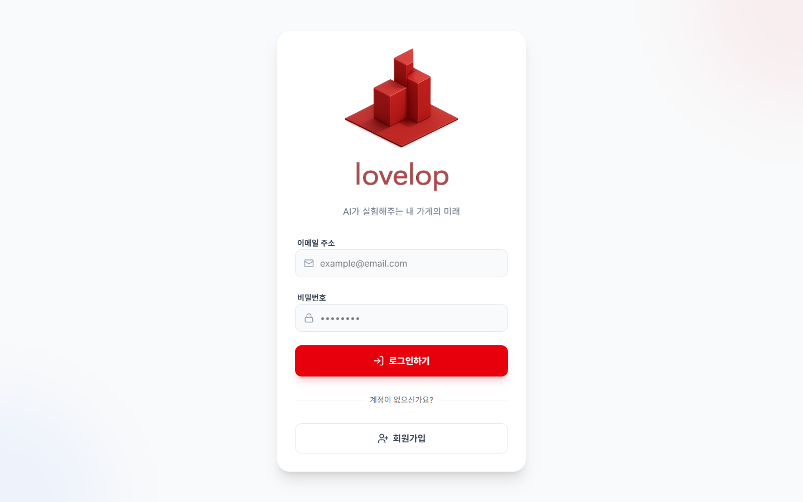
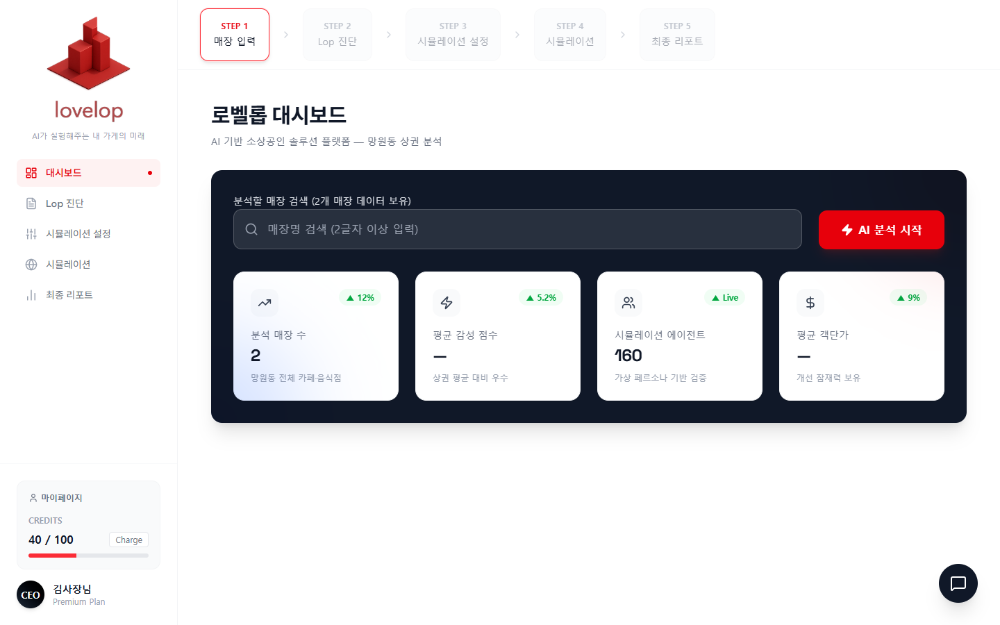
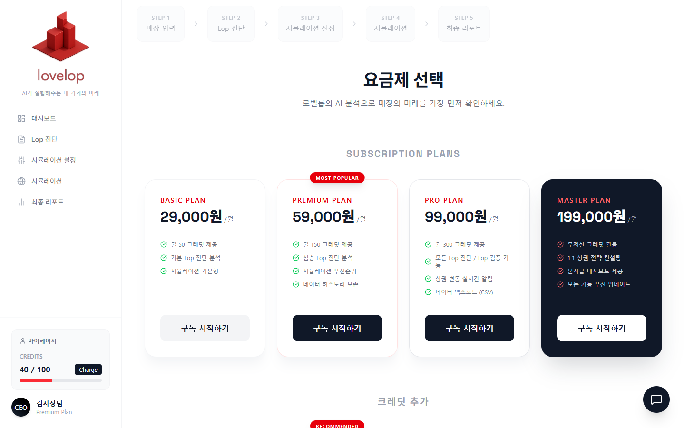
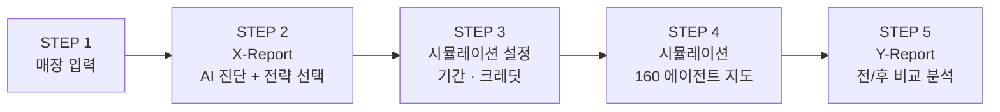
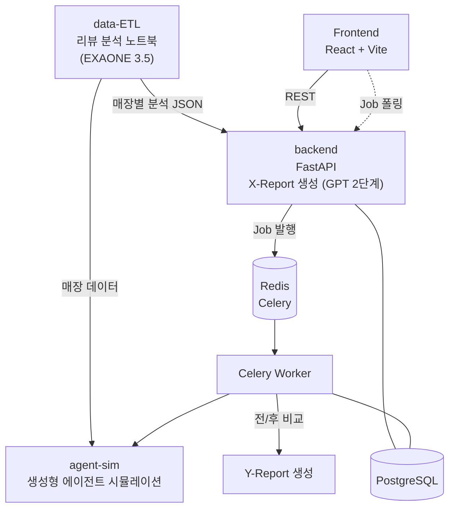

<p align="center">
  
</p>

<h1 align="center">lovelop (로벨롭)</h1>

<p align="center">
  <b>AI가 실험해주는 내 가게의 미래</b><br/>
  소상공인을 위한 AI 상권 분석 · 전략 시뮬레이션 플랫폼
</p>

> khai-likelion 조직에서 진행한 팀 프로젝트 5개(`agent-sim`, `Frontend`, `backend`, `llm-report`, `data-ETL`)를 한 저장소에 모았습니다. 각 폴더의 커밋 기록은 원본 그대로 유지됩니다.

---

## 1. 무엇을 하는 서비스인가요?

소상공인은 "메뉴를 바꾸면, 인테리어를 바꾸면 손님이 늘까?"를 **실제로 해 보기 전에는 알 수 없습니다.**
lovelop은 이 실험을 가상의 상권에서 대신 해 줍니다.

1. 매장의 리뷰·매출·유동인구 데이터를 LLM으로 분석해 **진단 리포트(X-Report)** 와 실행 가능한 전략 후보를 만듭니다.
2. 사장님이 고른 전략을 매장 데이터에 반영하고, 망원동 상권 위에서 **160명의 생성형 AI 에이전트**가 실제 도로망을 걸어 다니며 외식 의사결정을 하는 시뮬레이션을 돌립니다.
3. 전략 적용 **전/후**를 비교한 **최종 리포트(Y-Report)** 로 방문 수, 평점, 세대별 반응, 재방문율 등 11개 지표의 변화를 보여 줍니다.

| 항목 | 내용 |
|---|---|
| 대상 상권 | 서울 마포구 망원동 (매장 721곳) |
| 시뮬레이션 에이전트 | 160명 (세대 Z1·Z2·Y·X·S × 세그먼트별 페르소나) |
| 사용자 흐름 | 매장 입력 → 진단(X-Report) → 시뮬레이션 설정 → 시뮬레이션 → 최종 리포트(Y-Report) |

---

## 2. 화면 미리보기

> 아래 화면은 `Frontend`를 로컬에서 실행해 캡처한 것입니다. 백엔드는 연결하지 않았고 매장 목록 API만 예시 응답으로 대체했습니다. 그래서 대시보드의 "분석 매장 수 2" 같은 숫자는 실제 데이터가 아닙니다.

<table>
  <tr>
    <td width="50%"></td>
    <td width="50%"></td>
  </tr>
  <tr>
    <td align="center"><b>로그인</b><br/>이메일·비밀번호 로그인과 회원가입</td>
    <td align="center"><b>대시보드 (STEP 1 매장 입력)</b><br/>매장 검색, 5단계 스텝바, 크레딧 잔액</td>
  </tr>
  <tr>
    <td colspan="2"></td>
  </tr>
  <tr>
    <td colspan="2" align="center"><b>요금제</b> — 월 구독 4종(Basic · Premium · Pro · Master)과 크레딧 추가 구매</td>
  </tr>
</table>

진단 리포트(레이더 차트·전략 카드), 시뮬레이션 지도, 최종 리포트 화면의 구성은 [`Frontend/README.md`](./Frontend/README.md)와 [`Frontend/wireframe.md`](./Frontend/wireframe.md)에 정리되어 있습니다.

---

## 3. 서비스 흐름



## 4. 시스템 구성



---

## 5. 폴더별 설명

| 폴더 | 역할 | 주요 기술 | 상세 문서 |
|---|---|---|---|
| [**agent-sim**](./agent-sim) | 망원동 상권에서 160명의 LLM 에이전트가 5단계로 외식 의사결정을 내리는 시뮬레이션 엔진. 전략 적용 전/후를 비교하는 리포트와 Streamlit 대시보드 포함 | Python, Gemini/OpenAI, OSMnx, asyncio, Streamlit | [README](./agent-sim/README.md) |
| [**Frontend**](./Frontend) | 매장 입력부터 최종 리포트까지 5단계 사용자 화면. 레이더 차트, 전략 카드, Mapbox 에이전트 지도 | React 19, Vite, Tailwind CSS 4, Recharts, Mapbox GL | [README](./Frontend/README.md) |
| [**backend**](./backend) | REST API와 비동기 Job 큐. X-Report는 동기, 시뮬레이션과 Y-Report는 Celery로 처리하고 프론트가 Job을 폴링 | FastAPI, SQLAlchemy 2.0, Alembic, Celery, Redis, PostgreSQL | [README](./backend/README.md) |
| [**llm-report**](./llm-report) | X-Report(진단 리포트 + 전략 솔루션) 생성 로직의 프로토타입. 매장 JSON과 인구 데이터를 분석하고(1단계) 리포트로 작성(2단계)하는 GPT 파이프라인이며, 같은 로직이 `backend`의 `llm_gpt_provider.py`에 이식되어 있습니다 | Python, OpenAI API | [README](./llm-report/README.md) |
| [**data-ETL**](./data-ETL) | 매장 리뷰를 LLM으로 분석해 구조화 JSON으로 바꾸는 Colab 노트북 | Colab, Transformers, EXAONE-3.5-7.8B | [README](./data-ETL/README.md) |

---

## 6. 빠르게 실행해 보기

각 폴더는 독립적으로 실행할 수 있습니다. 환경변수와 API 키는 각 폴더의 `.env.example`을 참고하세요.

```bash
# 프론트엔드 (http://localhost:5173)
cd Frontend && npm install && npm run dev

# 백엔드 (http://localhost:8000)
cd backend && pip install -r requirements.txt && python -m uvicorn app.main:app --host 127.0.0.1 --port 8000

# 전략 전/후 비교 시뮬레이션 (.env에 LLM API 키 필요)
cd agent-sim && pip install -r requirements.txt
python scripts/run_before_after_sim.py --agents 160 --days 7 --target-store <매장명> --report <X-Report.md 경로>
```

`agent-sim`이 읽는 매장 데이터(`data/raw` 등)는 저장소에 포함되어 있지 않으므로, 실행하려면 별도로 준비해야 합니다.

전체 흐름을 로컬에서 확인하는 방법은 [`backend/docs/LOCAL_VERIFY.md`](./backend/docs/LOCAL_VERIFY.md), 프론트와 백엔드 사이의 API 계약은 [`backend/docs/FRONTEND_CONTRACT.md`](./backend/docs/FRONTEND_CONTRACT.md)를 참고하세요.

---

## 7. 원본 저장소

| 폴더 | 원본 저장소 |
|---|---|
| agent-sim | https://github.com/khai-likelion/agent-sim |
| Frontend | https://github.com/khai-likelion/Frontend |
| backend | https://github.com/khai-likelion/backend |
| llm-report | https://github.com/khai-likelion/llm-report |
| data-ETL | https://github.com/khai-likelion/data-ETL |
